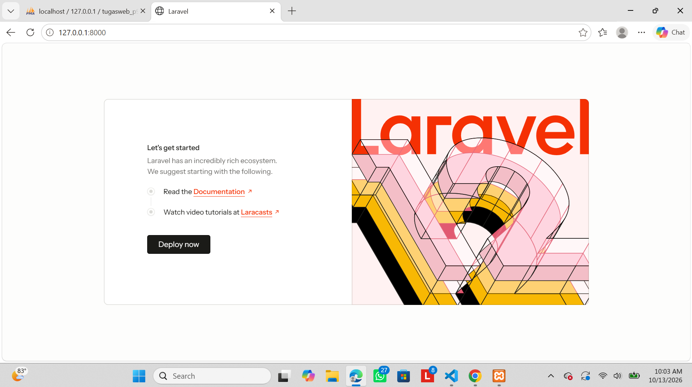
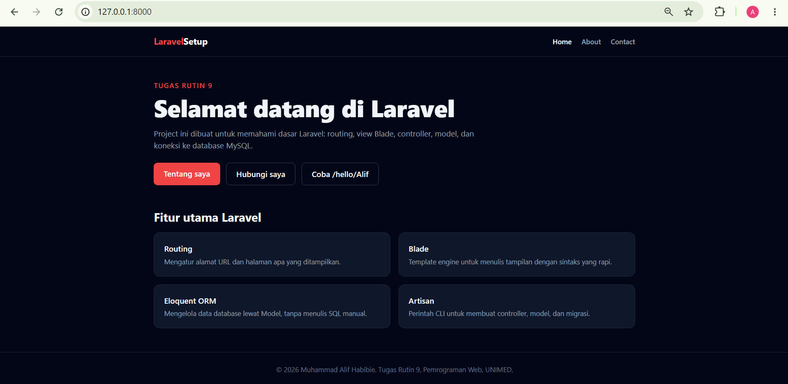

# TugasWeb-P9-LaravelSetup

Tugas Rutin 9 Pemrograman Web (UNIMED): setup Laravel, koneksi MySQL, routing, Blade, Controller, dan Model.

Mahasiswa: Muhammad Alif Habibie

## Fitur

- 3 route utama (`/`, `/about`, `/contact`) yang mengembalikan view Blade
- Data dinamis berupa array yang dikirim dari route ke view
- Form kontak dengan validasi, proteksi CSRF, dan penyimpanan ke MySQL lewat Model
- Bonus: styling Tailwind CSS (CDN) dan route berparameter `/hello/{nama}`

## Kebutuhan

- PHP 8.2 atau lebih baru
- Composer
- MySQL (XAMPP) dan phpMyAdmin

## Langkah instalasi

1. Clone repository
```bash
   git clone https://github.com/alifhabibie1510-beep/TugasWeb-P9-LaravelSetup.git
   cd TugasWeb-P9-LaravelSetup
```
2. Pasang dependensi
```bash
   composer install
```
3. Salin file environment lalu buat app key
```bash
   copy .env.example .env
   php artisan key:generate
```
   (di Linux/macOS pakai `cp .env.example .env`)
4. Buat database kosong bernama `tugasweb_p9` di phpMyAdmin. Sesuaikan `DB_USERNAME` dan `DB_PASSWORD` di `.env` jika perlu.
5. Jalankan migrasi
```bash
   php artisan migrate
```
6. Jalankan server
```bash
   php artisan serve
```
7. Buka http://127.0.0.1:8000

## Daftar route

| Method | URL | Keterangan |
|--------|-----|------------|
| GET | `/` | Halaman utama (data array dari route) |
| GET | `/about` | Profil dan tools (data array dari route) |
| GET | `/contact` | Form kontak (ContactController@create) |
| POST | `/contact` | Simpan pesan (ContactController@store) |
| GET | `/hello/{nama}` | Bonus: route berparameter |

## Struktur folder

```
TR9_LaravelSetup/
├── app/
│   ├── Http/Controllers/   Controller (C pada MVC): ContactController.php
│   └── Models/             Model (M pada MVC): Message.php
├── bootstrap/              Proses booting framework
├── config/                 Konfigurasi aplikasi
├── database/
│   └── migrations/         Skema tabel database (create_messages_table)
├── docs/                   Screenshot untuk README
├── public/                 Entry point web (index.php) dan aset publik
├── resources/
│   └── views/              View Blade (V pada MVC)
├── routes/
│   └── web.php             Definisi route
├── storage/                Log, cache, dan file sementara
├── vendor/                 Library Composer (tidak di-push ke Git)
├── .env                    Konfigurasi lokal/rahasia (tidak di-push)
├── .env.example            Contoh konfigurasi
├── artisan                 Perintah CLI Laravel
└── composer.json           Daftar dependensi
```

Alur MVC pada halaman Contact: **Route** menerima request, **Controller** memvalidasi dan memprosesnya, **Model** menyimpan ke database, lalu **View** menampilkan hasilnya.

## Keamanan

- Token CSRF (`@csrf`) pada semua form
- Validasi input di Controller (`$request->validate`)
- Output di Blade memakai `{{ }}` yang otomatis di-escape (aman dari XSS)
- Mass assignment dibatasi lewat `$fillable` di Model
- File `.env` tidak ikut di-push (sudah ada di `.gitignore`)

## Screenshot

Welcome page bawaan Laravel (`php artisan serve` berjalan):



Halaman Home:



Halaman About:


Halaman Contact:


Tabel `messages` di phpMyAdmin:

